  

<h1 align="center">Hi, I'm San 👋</h1>

<b>Python full-stack developer</b> · Kerala, India

  I build <b>FastAPI + PostgreSQL</b> backends, <b>React</b> front ends, <b>LLM-powered automation</b> and open-source Python tools published on <b>PyPI</b>. 
  I'm looking for a Python backend or full-stack developer role.

  
  
  

<a href="https://san-shibu.vercel.app">san-shibu.vercel.app</a> · <a href="https://www.linkedin.com/in/san-shibu-8250a9178/">linkedin.com/in/san-shibu-8250a9178</a> · <a href="mailto:sanshibu.dev@gmail.com">sanshibu.dev@gmail.com</a>

---

## What I've built

### [BakeriQ](https://github.com/scorpiocodex/bakeriq)

A WhatsApp-first bakery order management platform, built end to end during my full-stack internship at Digital Mesh Softech.

- FastAPI and PostgreSQL backend with Celery and Redis for background jobs
- Two React/Vite front ends (owner dashboard and customer ordering app), all run in Docker Compose
- A local Llama 3.2 model (via Ollama) turns free-text WhatsApp orders in English and Manglish into validated carts, at zero API cost
- 396 automated tests and 30 architecture decision records

### [ScorpioWatch](https://github.com/scorpiocodex/scorpiowatch) &nbsp;·&nbsp; [PyPI](https://pypi.org/project/scorpiowatch/)

An event-driven automation engine: it watches files, matches glob triggers and runs your commands through the `swatch` CLI.

- Commands run with no shell and an allow-listed environment; per-step timeouts stop the whole process group
- 100% test coverage with `mypy --strict`; releases ship through GitHub Actions and PyPI Trusted Publishing

### [Nyxora](https://github.com/scorpiocodex/Nyxora) &nbsp;·&nbsp; [PyPI](https://pypi.org/project/nyxora/)

An offline terminal password manager with a Textual TUI: Argon2id, XChaCha20-Poly1305 and per-entry HMAC integrity checks.

- Cross-platform CI with secret scanning, dependency CVE checks and 8 required merge checks
- A personal project; it has not been independently audited

---

## Activity

Drawn from my public GitHub activity and refreshed automatically.

---

## Stack

The same stack as text

| Area | Tools |
| --- | --- |
| **Languages** | Python · JavaScript · SQL · HTML/CSS |
| **Backend** | FastAPI · Celery · Redis · PostgreSQL · SQLAlchemy · Alembic · REST APIs · JWT · asyncio · Node.js · Express |
| **Frontend** | React · Vite · Tailwind CSS |
| **AI / LLM** | LLM integration · Ollama · Llama 3.2 · prompt engineering for structured data extraction |
| **DevOps & tools** | pytest · mypy · Docker · GitHub Actions (CI/CD) · Git · Linux · Vercel · Twilio API · Postman |

---

## Background

- Bachelor of Information Technology, Victoria University (major in Networking, minor in Programming)
- Software & AI Engineering Program, Scaler Academy (Nov 2026)

---

How this page is built

 

The images are generated by [`profilegen/`](profilegen), a small Python package with no dependencies, from [`data/profile.json`](data/profile.json) and live GitHub data. [A workflow](.github/workflows/update-profile.yml) refreshes them every Monday and whenever the generator changes. They are plain SVG with CSS animation: no scripts, nothing loaded from outside, and everything stays visible if animation is off or you prefer reduced motion. The terminal in the banner is a simulated session. The same generator draws the social-preview cards for the project repositories ([`assets/social`](assets/social)); GitHub has no API for those, so the PNGs are exported from the SVGs and uploaded by hand.

Fonts: Space Grotesk and JetBrains Mono, embedded as subsets under the SIL Open Font License ([`assets/fonts`](assets/fonts)).

