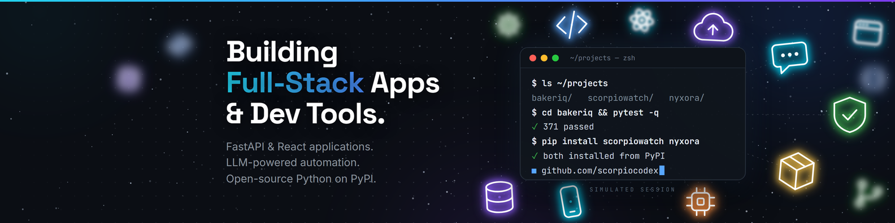

# Hi, I'm San 👋

Python full-stack developer based in Kerala, India. I build **FastAPI + PostgreSQL** backends, **React** front ends, **LLM-powered automation** and open-source Python tools published on **PyPI**.

I'm looking for a Python backend or full-stack developer role.

🌐 [Portfolio](https://san-shibu.vercel.app) &nbsp;·&nbsp; 💼 [LinkedIn](https://www.linkedin.com/in/san-shibu-8250a9178/) &nbsp;·&nbsp; ✉️ [sanshibu.dev@gmail.com](mailto:sanshibu.dev@gmail.com)

---

## What I've built

### [BakeriQ](https://github.com/scorpiocodex/bakeriq)

A WhatsApp-first bakery order management platform, built end to end during my full-stack internship at Digital Mesh Softech.

- FastAPI and PostgreSQL backend with Celery and Redis for background jobs
- Two React/Vite front ends (owner dashboard and customer ordering app), all run in Docker Compose
- A local Llama 3.2 model (via Ollama) turns free-text WhatsApp orders in English and Manglish into validated carts, at zero API cost
- 371 automated tests and 26 architecture decision records

### [ScorpioWatch](https://github.com/scorpiocodex/scorpiowatch) &nbsp;·&nbsp; [PyPI](https://pypi.org/project/scorpiowatch/)

An event-driven automation engine: it watches files, matches glob triggers and runs your commands through the `swatch` CLI.

- Commands run with no shell and an allow-listed environment; per-step timeouts stop the whole process group
- 100% test coverage with `mypy --strict`; releases ship through GitHub Actions and PyPI Trusted Publishing

### [Nyxora](https://github.com/scorpiocodex/Nyxora) &nbsp;·&nbsp; [PyPI](https://pypi.org/project/nyxora/)

An offline terminal password manager with a Textual TUI: Argon2id, XChaCha20-Poly1305 and per-entry HMAC integrity checks.

- Cross-platform CI with secret scanning, dependency CVE checks and 8 required merge checks
- A personal project; it has not been independently audited

---

## Stack

| | |
| --- | --- |
| **Languages** | Python · JavaScript · SQL · HTML/CSS |
| **Backend** | FastAPI · Celery · Redis · PostgreSQL · SQLAlchemy · Alembic · REST APIs · JWT · asyncio · Node.js · Express |
| **Frontend** | React · Vite · Tailwind CSS |
| **AI / LLM** | LLM integration · Ollama · Llama 3.2 · prompt engineering for structured data extraction |
| **DevOps & tools** | pytest · mypy · Docker · GitHub Actions (CI/CD) · Git · Linux · Vercel · Twilio API · Postman |

---

## Background

- Bachelor of Information Technology, Victoria University (major in Networking, minor in Programming)
- Software & AI Engineering Program, Scaler Academy (Nov 2026)
